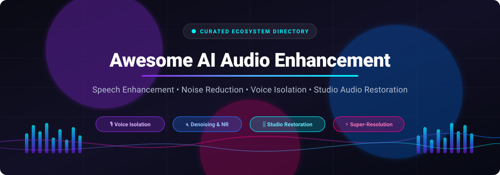

<p align="center">
  
</p>

<p align="center">
  <a href="https://github.com/ishandutta2007/Awesome-Awesome-Awesome"></a><a href="https://discord.gg/jc4xtF58Ve"></a>
  <a href="https://github.com/ishandutta2007/Awesome-AI-Audio-Enhancement/stargazers"></a>
  <a href="https://github.com/ishandutta2007/Awesome-AI-Audio-Enhancement/network/members"></a>
  <a href="https://github.com/ishandutta2007/Awesome-AI-Audio-Enhancement/issues"></a>
  <a href="https://github.com/ishandutta2007/Awesome-AI-Audio-Enhancement/pulls"></a>
  <a href="https://github.com/ishandutta2007"></a>
</p>

---

# 🎧 Awesome AI Audio Enhancement

> **A curated, comprehensive directory of enterprise SaaS platforms, state-of-the-art neural models, and open-source GitHub projects for speech enhancement, voice isolation, real-time noise reduction, and studio-grade audio restoration.**

Whether you are building automated podcast pipelines, telecommunication systems, voiceover studios, or edge inference applications, this repository catalogs the best solutions in deep learning audio engineering.

---

## 📑 Table of Contents

- [📊 Sector Overview & Market Dynamics](#-sector-overview--market-dynamics)
- [☁️ SaaS & Hosted Platforms](#️-saas--hosted-platforms)
- [💻 Open-Source GitHub Projects](#-open-source-github-projects)
- [🛠️ Architectural Pipelines & Blueprints](#️-architectural-pipelines--blueprints)
- [🤝 How to Contribute](#-how-to-contribute)
- [⚠️ Disclaimer & Ethical AI Usage](#️-disclaimer--ethical-ai-usage)
- [⭐ Star History](#-star-history)
- [💖 Support & Sponsoring](#-support--sponsoring)

---

## 📊 Sector Overview & Market Dynamics

The global AI audio enhancement and speech processing market was estimated at **$1.8 billion to $2.4 billion** and is projected to expand past **$7.5 billion by 2030**, driven by rapid adoption in video production, remote collaboration, call center transcription intelligence, and generative media (compounding at a CAGR of ~25–28%).

The sector exhibits **moderate fragmentation with a barbell dynamic** rather than a winner-take-all monopoly: established media and telecommunications conglomerates (Adobe, Dolby) hold dominant footholds across enterprise broadcast and API integration layers, while specialized generative AI unicorns (ElevenLabs, Descript, Krisp) command fast-growing consumer and creator workflows. Concurrently, a vibrant long-tail of bootstrapped utility SaaS and open-source models thrives by addressing specific developer, privacy, and self-hosting requirements.

---

## ☁️ SaaS & Hosted Platforms

Below is the comparative breakdown of leading AI audio enhancement platforms, ranked in descending order by **company scale (valuation / annual revenue)**.

| 🏢 Platform / Tool | 🛠️ Core Capabilities & Audio Engine | 📈 Company Scale (Valuation / Revenue) | 💳 Starting Paid Tier Pricing | 🎁 Free Tier / Trial Limits |
| :--- | :--- | :--- | :--- | :--- |
| **[Adobe Podcast](https://podcast.adobe.com/enhance)** | Web-based Enhance Speech voice isolation, background noise elimination, room reverb suppression, and virtual mic check analysis. | **~$215B Market Cap**<br>*(~$21.4B Annual Rev; NASDAQ: ADBE)* | **$9.99/mo**<br>*(Express / Podcast Premium, billed annually)* | **Free Forever Plan**:<br>• Up to 1 hr/day total processing<br>• Max 30 min / 500 MB per file<br>• Audio-only (no video export) |
| **[Dolby.io](https://dolby.io/)** | Cloud media processing APIs providing loudness normalization, intelligent noise suppression, dynamic EQ, and speech isolation. | **~$7.5B Market Cap**<br>*(~$1.3B Annual Rev; NYSE: DLB)* | **$0.05 / minute**<br>*(Pay-as-you-go consumption model)* | **Free Forever Allowance**:<br>• 200 free processing mins/month<br>• or $50 promotional trial credit (valid for 30 days) |
| **[ElevenLabs Studio](https://elevenlabs.io/studio)** | Voice Isolator neural denoiser extracting clean vocals from extreme background noise; 30+ language voice synthesis, cloning, and sound FX. | **~$3.3B Valuation**<br>*(~$100M+ ARR, Series C Unicorn)* | **$5.00/mo**<br>*(Starter tier: 30,000 credits/mo ~30 min audio; $1 for 1st mo) or $0.12/min API* | **Free Forever Plan**:<br>• 10,000 credits/month (~10 min Voice Isolator)<br>• Max 1 hr / 500 MB per file<br>• Non-commercial with attribution |
| **[Resemble AI](https://www.resemble.ai/)** | Resemble Enhance neural denoiser utilizing 2D UNet and flow matching for speech restoration, voice cloning, and deepfake detection. | **~$500M - $2.0B Valuation**<br>*(~$25M - $50M ARR; Series B)* | **$0/mo base Flex tier**<br>*(Pay-as-you-go from $0.0005/sec for generation; $0.006/sec audio tools) or $19/mo Creator* | **Free Trial / Sandbox**:<br>• 1 free custom voice clone creation<br>• Web enhance interactive demo<br>• $0 upfront commitment builder credits |
| **[Descript Studio Sound](https://help.descript.com/effects-animations-transitions/studio-sound)** | Studio Sound AI audio effect removing room reverb, echo, and background rumble with an intensity slider, paired with multitrack transcript editing. | **~$570M Valuation**<br>*(~$55M ARR; Series C backed by OpenAI Startup Fund)* | **$16.00/mo**<br>*(Hobbyist tier billed annually; or $24.00/mo monthly; 10 media hrs/mo)* | **Free Forever Plan**:<br>• 1 media hour (60 min) per month<br>• 100 starter AI credits pool (one-time)<br>• 720p export limit, 5 GB storage |
| **[Krisp](https://krisp.ai/)** | Real-time bidirectional noise cancellation, room echo removal, competing voice filtering, and automated meeting transcription. | **~$300M Valuation**<br>*(~$40M ARR; backed by RTP Global & Storm Ventures)* | **$8.00/user/mo**<br>*(Core plan billed annually; or $16.00/mo monthly; unlimited noise cancellation)* | **Free Forever Plan**:<br>• 60 min/day bidirectional AI noise removal<br>• 2 AI meeting summaries/day<br>• 7-day transcription history (or 7-day Pro trial) |
| **[Podcastle](https://podcastle.ai/)** | Magic Dust one-click audio restoration, equalizer auto-tuning, plosive leveling, multitrack remote recording, and AI audio transcription. | **~$60M Valuation**<br>*(~$9.7M ARR; Series A backed by Mosaic Ventures & AI Fund)* | **$11.99/mo**<br>*(Essentials plan billed annually; or $14.99/mo monthly; 450 AI credits/mo)* | **Free Forever Plan**:<br>• 3 hours recording/editing per month<br>• 10 Magic Dust enhancements/month<br>• 2 GB cloud storage, 720p video export |
| **[Lalal.ai](https://www.lalal.ai/)** | 8-stem AI source separation engine, vocal/instrumental extraction, and Voice Cleaner algorithm for vocal reverb and artifact removal. | **~$8M ARR**<br>*(Bootstrapped & profitable; Omnisale GmbH)* | **$7.50/mo**<br>*(Lite plan billed annually at $90/yr; or $9.99/mo monthly; 90 Fast Queue mins/mo)* | **Free Forever Starter Plan**:<br>• 10 minutes total stem splitting & denoising preview<br>• 200 MB maximum file upload size |
| **[Auphonic](https://auphonic.com/)** | Studio Voice speech reconstruction, adaptive multitrack leveling, mic bleed removal, dynamic denoising segment editor, and silence cutter. | **~$3M ARR**<br>*(Bootstrapped & profitable; Austria)* | **$11.00/mo**<br>*(Plan S billed annually at $132/yr; or $13.00/mo monthly; 9 hrs audio/mo)* | **Free Forever Plan**:<br>• 2 hours processed audio per month<br>• Multitrack limited to <20 min<br>• Includes Auphonic branding jingle |
| **[Cleanvoice AI](https://cleanvoice.ai/)** | Removes filler words ("um", "uh"), mouth clicks, lip smacks, heavy breaths, and stuttering; includes studio sound EQ and REST API. | **~$1M ARR**<br>*(Bootstrapped indie SaaS; profitable)* | **€10.00/mo (~$11/mo)**<br>*(10 hours processed audio/mo; or pay-as-you-go €10 for 5 hours pack)* | **Free Trial Credit**:<br>• 30 minutes of free audio processing credit on signup<br>• No credit card required<br>• Credits do not expire |

---

## 💻 Open-Source GitHub Projects

Explore the premier open-source audio restoration models, stem separators, and speech enhancement toolkits. Projects are sorted in descending order by **GitHub Star Count**.

1. **[deezer/spleeter](https://github.com/deezer/spleeter)** [](https://github.com/deezer/spleeter/stargazers)  
   *Deezer's ultra-fast audio source separation library written in Python/TensorFlow. Separates music and speech into 2-stem, 4-stem, or 5-stem stems.*  
   `License: MIT` • `Domain: Source Separation / Stem Extraction`

2. **[k2-fsa/sherpa-onnx](https://github.com/k2-fsa/sherpa-onnx)** [](https://github.com/k2-fsa/sherpa-onnx/stargazers)  
   *Offline multi-platform speech toolkit supporting real-time speech enhancement, noise suppression, voice activity detection (VAD), speaker identification, and ASR/TTS across Linux, macOS, Windows, Android, iOS, and Raspberry Pi via ONNX Runtime.*  
   `License: Apache-2.0` • `Domain: Speech Enhancement / VAD / Embedded Processing`

3. **[facebookresearch/demucs](https://github.com/facebookresearch/demucs)** [](https://github.com/facebookresearch/demucs/stargazers)  
   *State-of-the-art music source separation and vocal extraction architecture from Meta AI based on Hybrid Transformers and U-Nets (HT Demucs).*  
   `License: MIT` • `Domain: Source Separation / Vocal Isolation`

4. **[xiph/rnnoise](https://github.com/xiph/rnnoise)** [](https://github.com/xiph/rnnoise/stargazers)  
   *Mozilla & Xiph.Org's classic recurrent neural network for real-time speech noise suppression. Extremely lightweight, optimized for real-time CPU telephony and VoIP.*  
   `License: BSD-3-Clause` • `Domain: Real-Time Denoising / DSP-RNN`

5. **[Rikorose/DeepFilterNet](https://github.com/Rikorose/DeepFilterNet)** [](https://github.com/Rikorose/DeepFilterNet/stargazers)  
   *Full-band (48 kHz) audio speech enhancement and noise suppression framework implementing deep filtering. Ultra low latency, written in Rust and Python with PyTorch/ONNX inference.*  
   `License: MIT` • `Domain: Real-Time Full-Band Denoising`

6. **[modelscope/ClearerVoice-Studio](https://github.com/modelscope/ClearerVoice-Studio)** [](https://github.com/modelscope/ClearerVoice-Studio/stargazers)  
   *All-in-one AI speech processing and audio enhancement studio from Alibaba ModelScope. Implements speech enhancement, target speaker extraction, speech separation, and super-resolution.*  
   `License: Apache-2.0` • `Domain: Speech Enhancement & Separation Studio`

7. **[resemble-ai/resemble-enhance](https://github.com/resemble-ai/resemble-enhance)** [](https://github.com/resemble-ai/resemble-enhance/stargazers)  
   *Two-stage neural speech enhancement framework combining a 2D UNet denoiser with conditional flow matching for studio-grade acoustic restoration. Also available on Apple Silicon via [MLX weights](https://huggingface.co/smcleod/resemble-enhance-mlx).*  
   `License: CC-BY-NC-4.0` • `Domain: Studio Sound Restoration / Flow Matching`

8. **[haoheliu/versatile_audio_super_resolution](https://github.com/haoheliu/versatile_audio_super_resolution)** [](https://github.com/haoheliu/versatile_audio_super_resolution/stargazers)  
   *AudioSR: versatile diffusion-based audio super-resolution and bandwidth extension model capable of upsampling any 16 kHz or 24 kHz audio to pristine 48 kHz studio sound.*  
   `License: Apache-2.0` • `Domain: Audio Super-Resolution / Bandwidth Extension`

9. **[facebookresearch/denoiser](https://github.com/facebookresearch/denoiser)** [](https://github.com/facebookresearch/denoiser/stargazers)  
   *Real-time raw waveform speech enhancement using end-to-end causal convolutional networks (Demucs-based) from Meta AI.*  
   `License: CC-BY-NC-4.0` • `Domain: Waveform Speech Denoising`

10. **[sigsep/open-unmix-pytorch](https://github.com/sigsep/open-unmix-pytorch)** [](https://github.com/sigsep/open-unmix-pytorch/stargazers)  
    *Reference deep neural network implementation for music source separation and stem extraction in PyTorch with pre-trained models and TorchScript export.*  
    `License: MIT` • `Domain: Source Separation / PyTorch Reference`

11. **[microsoft/DNS-Challenge](https://github.com/microsoft/DNS-Challenge)** [](https://github.com/microsoft/DNS-Challenge/stargazers)  
    *Microsoft Deep Noise Suppression Challenge codebase, baseline deep learning architectures, acoustic datasets, and DNSMOS objective audio quality evaluators.*  
    `License: MIT` • `Domain: Benchmarking / Acoustic Datasets / DNSMOS`

12. **[kuleshov/audio-super-res](https://github.com/kuleshov/audio-super-res)** [](https://github.com/kuleshov/audio-super-res/stargazers)  
    *Deep learning neural network implementation for audio super-resolution and high-frequency spectral reconstruction from downsampled audio recordings.*  
    `License: MIT` • `Domain: Audio Super-Resolution / CNN Upsampling`

13. **[santi-pdp/segan](https://github.com/santi-pdp/segan)** [](https://github.com/santi-pdp/segan/stargazers)  
    *Pioneering Speech Enhancement Generative Adversarial Network (SEGAN) processing raw time-domain waveforms to eliminate ambient background disturbances.*  
    `License: MIT` • `Domain: Waveform GAN Enhancement`

14. **[NVIDIA/CleanUNet](https://github.com/NVIDIA/CleanUNet)** [](https://github.com/NVIDIA/CleanUNet/stargazers)  
    *NVIDIA's causal speech denoising and dereverberation model featuring an end-to-end 1D U-Net architecture enriched with cross-channel self-attention.*  
    `License: BSD-3-Clause` • `Domain: Speech Dereverberation & Denoising`

15. **[jisoo-o/UniVoiceLite](https://github.com/jisoo-o/UniVoiceLite)** [](https://github.com/jisoo-o/UniVoiceLite/stargazers)  
    *Lightweight unsupervised audio-visual speech enhancement and speaker separation framework utilizing facial visual cues, lip movement, and Wasserstein distance regularization.*  
    `License: MIT` • `Domain: Audio-Visual Multimodal Separation`

16. **[teachingpython/post-production](https://github.com/teachingpython/post-production)** [](https://github.com/teachingpython/post-production/stargazers)  
    *Command-line automation pipeline for podcast post-production integrating Dolby.io enhancement APIs, AssemblyAI transcription, filler-word trimming, and transcoding.*  
    `License: MIT` • `Domain: Podcast Post-Production CLI Automation`

---

## 🛠️ Architectural Pipelines & Blueprints

You can combine open-source building blocks into a production-ready, fully self-hosted audio enhancement pipeline:

```
[Raw Noisy Input Audio]
         │
         ▼
┌─────────────────────────────────┐
│   1. Real-Time Denoising        │  ──►  DeepFilterNet / RNNoise / CleanUNet
│   (Ambient Noise & Hiss Filter) │
└─────────────────────────────────┘
         │
         ▼
┌─────────────────────────────────┐
│   2. Source & Voice Separation  │  ──►  Demucs / Spleeter / ClearerVoice
│   (Vocal Isolation & De-bleeding│
└─────────────────────────────────┘
         │
         ▼
┌─────────────────────────────────┐
│   3. Studio Acoustic Modeling   │  ──►  Resemble Enhance (Flow Matching)
│   (Spectral Masking & Resynthes)│
└─────────────────────────────────┘
         │
         ▼
┌─────────────────────────────────┐
│   4. Bandwidth Extension (SR)   │  ──►  AudioSR (Diffusion Super-Res)
│   (Upsampling to 48 kHz Master) │
└─────────────────────────────────┘
         │
         ▼
[Broadcast-Ready Studio Master]
```

- **Microphone & VoIP Streaming**: `xiph/rnnoise` or `k2-fsa/sherpa-onnx` on CPU/edge.
- **Podcast & Interview Processing**: `Rikorose/DeepFilterNet` + `resemble-ai/resemble-enhance`.
- **Music & Stem Post-Production**: `facebookresearch/demucs` + `haoheliu/versatile_audio_super_resolution`.

---

## 🤝 How to Contribute

We welcome contributions from researchers, creators, and audio software engineers!

1. 🍴 **Fork the repository** on GitHub.
2. 🌿 **Create a descriptive feature branch** (`git checkout -b add-my-audio-tool`).
3. 📝 **Add or update entries in `README.md`**:
   - For SaaS tools: include company scale, verified starting price tier, and exact free tier/trial limits.
   - For Open-Source repositories: include repository link, star count badge, license, and brief description.
4. 🚀 **Submit a Pull Request** with a concise explanation of why the tool belongs in this list.

---

## ⚠️ Disclaimer & Ethical AI Usage

- **Community-Curated**: This list is maintained for educational, technical, and research reference. Inclusion does not imply commercial endorsement.
- **Data Privacy & Compliance**: AI audio enhancement tools processing biometrics, human voice, or private conversations must comply with relevant data protection statutes (GDPR, CCPA, HIPAA) and appropriate speaker consent standards.
- **Licensing Restrictions**: Check upstream repository licenses carefully before commercial deployment (e.g., non-commercial clauses such as `CC-BY-NC-4.0` in select generative weights).

---

## ⭐ Star History

[](https://star-history.dera.page/#ishandutta2007/Awesome-AI-Audio-Enhancement&type=date&legend=top-left)

---

## 💖 Support & Sponsoring

If you found this curated ecosystem directory helpful for your audio projects, research, or content creation workflows, please consider supporting the project:

- ⭐ **Star this repository** on GitHub to amplify its reach.
- 🍴 **Fork and contribute** your favorite tools and open-source models.
- 📢 **Share with fellow creators** and engineers across Discord, X (Twitter), and Reddit.
- ☕ **Sponsor or buy a coffee**: [Support @ishandutta2007 on GitHub Sponsors](https://github.com/sponsors/ishandutta2007)

Thank you for supporting the open audio engineering community! 🎙️🎧✨
# Awesome-AI-Audio-Enhancement

